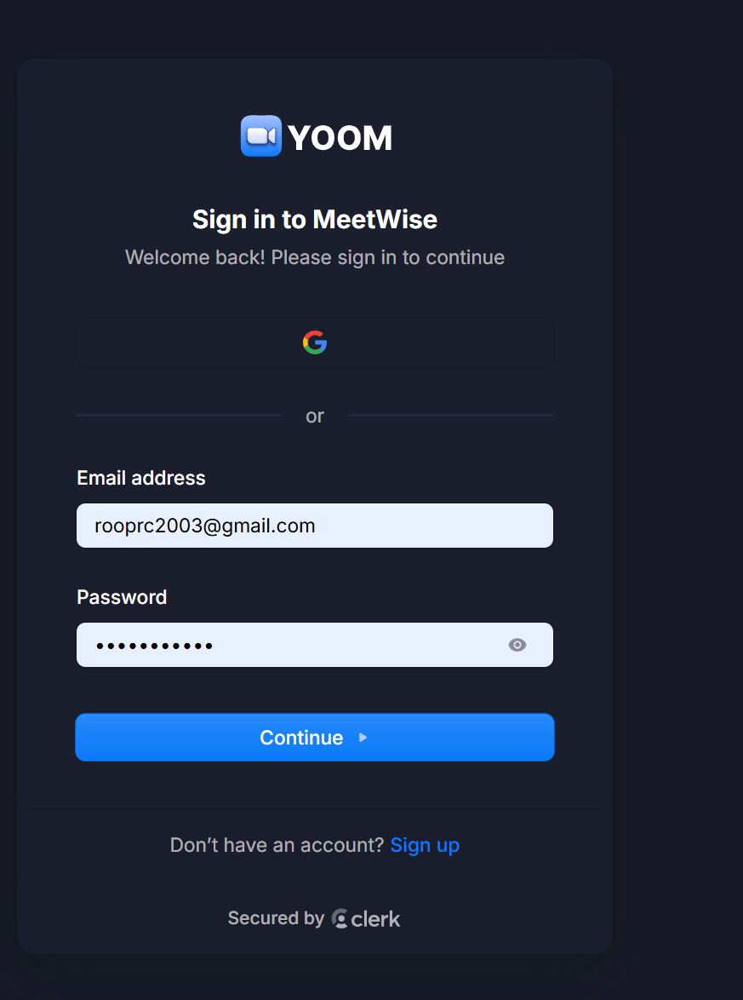

# 🎙️ AI-Based Smart Meeting Analyzer

> A full-stack, AI-powered meeting platform that lets you **host live video meetings**, **transcribe audio/video recordings** with speaker diarization, and generate **AI-powered summaries** — all in one place.

---

## 📸 Screenshots

### 🔐 Sign In Page


### 🏠 Home Dashboard


### 🎥 Meeting Room


### 🤖 AI Transcription Output


---

## 📋 Table of Contents

- [Overview](#-overview)
- [Features](#-features)
- [Tech Stack](#-tech-stack)
- [Architecture & System Flow](#-architecture--system-flow)
- [Project Structure](#-project-structure)
- [Pages & Routes](#-pages--routes)
- [Component Reference](#-component-reference)
- [Backend API Reference](#-backend-api-reference)
- [Environment Variables](#-environment-variables)
- [Getting Started](#-getting-started)
- [How It Works — Step by Step](#-how-it-works--step-by-step)
- [AI Pipeline Explained](#-ai-pipeline-explained)
- [Data Flow Diagram](#-data-flow-diagram)

---

## 🌟 Overview

**AI-Based Smart Meeting Analyzer (MeetWise)** is a Next.js 14 web application that combines:

1. **Real-time video conferencing** powered by Stream Video SDK
2. **AI-driven transcription** with speaker diarization (who said what, when)
3. **Automatic meeting summarization** via OpenAI GPT
4. **Report generation** — export your transcript + summary as PDF, TXT, or DOCX

The app is split into two parts:
- **Frontend** — Next.js 14 App Router application (TypeScript + Tailwind CSS)
- **Backend** — Python FastAPI server (not included in this repo) that handles audio processing, Whisper transcription, speaker diarization via pyannote.audio, and OpenAI summarization

---

## ✨ Features

| Feature | Description |
|---|---|
| 🎥 **Instant Meetings** | Start a live video call with one click |
| 📅 **Schedule Meetings** | Plan meetings with date/time picker |
| 🔗 **Join via Link** | Join any meeting using an invitation link |
| 🏠 **Personal Room** | Each user has a permanent personal meeting room |
| 📼 **Recordings** | Browse and replay past meeting recordings |
| 🎙️ **AI Transcription** | Upload audio/video → get time-stamped, speaker-labeled transcript |
| 🤖 **AI Summary** | Automatic GPT-powered meeting summary |
| 📄 **Export Reports** | Download transcript + summary as PDF, TXT, or Word DOCX |
| 👥 **Speaker Diarization** | Distinguish up to 4 speakers with color-coded labels |
| 🔒 **Authentication** | Secure sign-in/sign-up with Clerk |
| 📱 **Responsive Design** | Works on desktop and mobile |
| 🩺 **Backend Health Check** | Live indicator showing whether the AI backend is connected |

---

## 🛠️ Tech Stack

### Frontend

| Technology | Version | Purpose |
|---|---|---|
| **Next.js** | 14.1.3 | React framework with App Router & Server Actions |
| **TypeScript** | ^5 | Type safety across the entire codebase |
| **Tailwind CSS** | ^3.3 | Utility-first CSS styling |
| **Clerk** | ^5.0 | Authentication & user management |
| **Stream Video React SDK** | ^0.5.1 | Real-time video conferencing |
| **Stream Node SDK** | ^0.1.12 | Server-side token generation for Stream |
| **Radix UI** | Various | Accessible headless UI components (Dialog, Dropdown, Popover, Toast) |
| **jsPDF** | ^3.0.2 | Client-side PDF generation |
| **React DatePicker** | ^6.3 | Date & time picker for scheduling |
| **Lucide React** | ^0.350 | Icon library |
| **date-fns** | ^3.4 | Date formatting utilities |
| **ws** | ^8.18 | WebSocket client for real-time transcription streaming |
| **uuid** | ^9.0 | Unique ID generation for meeting rooms |

### Backend (Python — separate service)

| Technology | Purpose |
|---|---|
| **FastAPI** | REST API server |
| **OpenAI Whisper** | Speech-to-text transcription |
| **pyannote.audio** | Speaker diarization (who spoke when) |
| **OpenAI GPT** | Meeting summarization |
| **python-docx** | DOCX report generation |
| **Google Cloud Speech** | Alternative real-time transcription (via WebSocket) |

### DevTools

| Tool | Purpose |
|---|---|
| **ESLint** | Code linting |
| **Prettier** | Code formatting |
| **PostCSS** | CSS processing |
| **Autoprefixer** | CSS vendor prefixing |

---

## 🏗️ Architecture & System Flow

```
┌─────────────────────────────────────────────────────────────┐
│                        USER BROWSER                          │
│                                                             │
│  ┌──────────────────────────────────────────────────────┐   │
│  │            Next.js 14 Frontend (Port 3000)           │   │
│  │                                                      │   │
│  │  ┌─────────────┐  ┌──────────────┐  ┌────────────┐  │   │
│  │  │  Clerk Auth  │  │ Stream Video │  │ AI Upload  │  │   │
│  │  │  (Sign In/  │  │   (Live VC)  │  │  & Report  │  │   │
│  │  │   Sign Up)  │  │              │  │  Feature   │  │   │
│  │  └──────┬──────┘  └──────┬───────┘  └─────┬──────┘  │   │
│  └─────────┼────────────────┼────────────────┼──────────┘   │
└────────────┼────────────────┼────────────────┼──────────────┘
             │                │                │
             ▼                ▼                ▼
    ┌─────────────┐  ┌────────────────┐  ┌──────────────────┐
    │  Clerk API  │  │  Stream.io API │  │  Python Backend  │
    │  (Auth SaaS)│  │  (Video SaaS)  │  │  (FastAPI :8000) │
    └─────────────┘  └────────────────┘  └────────┬─────────┘
                                                   │
                              ┌────────────────────┼──────────────────┐
                              │                    │                  │
                              ▼                    ▼                  ▼
                     ┌──────────────┐    ┌──────────────┐   ┌──────────────┐
                     │   Whisper    │    │  pyannote.   │   │  OpenAI GPT  │
                     │  (Transcribe)│    │  audio (Who  │   │  (Summarize) │
                     └──────────────┘    │  spoke when) │   └──────────────┘
                                         └──────────────┘
```

---

## 📁 Project Structure

```
AI-Based-Smart-Meeting-Analyzer/
└── frontend/                          # Next.js 14 Application
    │
    ├── 📁 app/                        # App Router (Next.js 14)
    │   ├── layout.tsx                 # Root layout (fonts, metadata)
    │   ├── globals.css                # Global styles & Tailwind directives
    │   │
    │   ├── 📁 (auth)/                 # Authentication route group (no sidebar)
    │   │   ├── sign-in/
    │   │   │   └── [[...sigin-in]]/
    │   │   │       └── page.tsx       # Clerk hosted sign-in page
    │   │   └── sign-up/
    │   │       └── [[...sign-up]]/
    │   │           └── page.tsx       # Clerk hosted sign-up page
    │   │
    │   └── 📁 (root)/                 # Main app route group (with sidebar + navbar)
    │       ├── layout.tsx             # Root layout: StreamVideoProvider wrapper
    │       │
    │       ├── 📁 (home)/             # Dashboard route group
    │       │   ├── layout.tsx         # Home layout: Navbar + Sidebar
    │       │   ├── page.tsx           # 🏠 Home / Dashboard page
    │       │   ├── upcoming/
    │       │   │   └── page.tsx       # 📅 Upcoming meetings list
    │       │   ├── previous/
    │       │   │   └── page.tsx       # ⏮️  Past meetings list
    │       │   ├── recordings/
    │       │   │   └── page.tsx       # 📼 Meeting recordings browser
    │       │   ├── personal-room/
    │       │   │   └── page.tsx       # 🏠 Personal permanent meeting room
    │       │   └── transcription/
    │       │       ├── page.tsx       # 🎙️ AI Transcription & Summary (MAIN)
    │       │       ├── page-new.tsx   # Alternate transcription UI (draft)
    │       │       └── page-backup.tsx # Backup version
    │       │
    │       └── 📁 meeting/
    │           └── [id]/
    │               └── page.tsx       # 🎥 Live meeting room (dynamic route)
    │
    ├── 📁 components/                 # Reusable UI components
    │   ├── Navbar.tsx                 # Top navigation bar with logo & user avatar
    │   ├── Sidebar.tsx                # Left sidebar with navigation links
    │   ├── MobileNav.tsx              # Hamburger menu for mobile screens
    │   ├── HomeCard.tsx               # Dashboard action cards (New/Join/Schedule/Recordings)
    │   ├── MeetingTypeList.tsx        # Grid of meeting action cards + modals
    │   ├── MeetingModal.tsx           # Reusable modal dialog for meeting actions
    │   ├── MeetingRoom.tsx            # Live video room with controls & layouts
    │   ├── MeetingSetup.tsx           # Pre-call setup screen (cam/mic preview)
    │   ├── MeetingCard.tsx            # Card displaying a past/upcoming meeting
    │   ├── CallList.tsx               # List of calls (upcoming/previous/recordings)
    │   ├── EndCallButton.tsx          # Button to end meeting for all participants
    │   ├── BackendStatus.tsx          # Backend health indicator badge
    │   ├── Alert.tsx                  # Alert/notification component
    │   ├── Loader.tsx                 # Spinner/loading state component
    │   │
    │   └── 📁 ui/                     # Shadcn/Radix UI primitives
    │       ├── button.tsx
    │       ├── card.tsx
    │       ├── dialog.tsx
    │       ├── dropdown-menu.tsx
    │       ├── input.tsx
    │       ├── popover.tsx
    │       ├── sheet.tsx
    │       ├── textarea.tsx
    │       ├── toast.tsx
    │       ├── toaster.tsx
    │       └── use-toast.ts
    │
    ├── 📁 actions/                    # Next.js Server Actions
    │   └── stream.actions.ts          # tokenProvider: generates Stream auth tokens server-side
    │
    ├── 📁 hooks/                      # Custom React hooks
    │   ├── useGetCalls.ts             # Fetches upcoming/ended/recordings from Stream
    │   ├── useGetCallById.ts          # Fetches a single call by ID
    │   └── useBackendHealth.ts        # Polls backend /health endpoint every 30s
    │
    ├── 📁 lib/                        # Utility functions & API client
    │   ├── api.ts                     # Backend REST API client (upload, downloadReport, healthCheck)
    │   └── utils.ts                   # cn() — Tailwind className merger
    │
    ├── 📁 providers/                  # React context providers
    │   └── StreamClientProvider.tsx   # Wraps app with StreamVideo client
    │
    ├── 📁 constants/                  # App-wide constants
    │   └── index.ts                   # sidebarLinks[], avatarImages[]
    │
    ├── 📁 public/                     # Static assets
    │   ├── 📁 icons/                  # SVG icons (Home, Video, schedule, etc.)
    │   ├── 📁 images/                 # Avatar images, hero background
    │   ├── 📁 js/
    │   │   └── transcription.js       # Vanilla JS WebSocket transcription client
    │   ├── index.html                 # Static HTML fallback
    │   └── transcription.html         # Standalone transcription UI (vanilla)
    │
    ├── 📁 server/                     # Node.js WebSocket/transcription proxy server
    │   ├── server.js                  # Express + Socket.IO server entry point
    │   └── transcription-service.js   # Google Cloud Speech WebSocket streaming bridge
    │
    ├── middleware.ts                  # Clerk auth middleware (protects routes)
    ├── next.config.mjs                # Next.js configuration
    ├── tailwind.config.ts             # Tailwind CSS configuration
    ├── tsconfig.json                  # TypeScript configuration
    ├── postcss.config.js              # PostCSS configuration
    ├── components.json                # Shadcn UI configuration
    ├── .eslintrc.json                 # ESLint rules
    ├── .prettierrc                    # Prettier formatting rules
    ├── package.json                   # npm dependencies & scripts
    └── env.txt                        # Environment variable template (keys redacted)
```

---

## 🗺️ Pages & Routes

| Route | Page | Auth Required | Description |
|---|---|---|---|
| `/sign-in` | Sign In | ❌ Public | Clerk-hosted sign-in |
| `/sign-up` | Sign Up | ❌ Public | Clerk-hosted sign-up |
| `/` | Home | ✅ Protected | Dashboard with 4 action cards |
| `/upcoming` | Upcoming | ✅ Protected | Scheduled upcoming meetings |
| `/previous` | Previous | ✅ Protected | Past ended meetings |
| `/recordings` | Recordings | ✅ Protected | Browse recorded meetings |
| `/personal-room` | Personal Room | ✅ Protected | Your permanent meeting room |
| `/meeting/[id]` | Meeting Room | ✅ Protected | Live video conference |
| `/transcription` | AI Analyzer | ✅ Protected | Upload audio → transcript + summary |

---

## 🧩 Component Reference

### `MeetingTypeList`
The dashboard's main action grid. Renders 4 `HomeCard` components and manages modal state for:
- **New Meeting** → starts instant call, redirects to `/meeting/[id]`
- **Schedule Meeting** → modal with description + `ReactDatePicker`; on creation shows copyable invite link
- **Join Meeting** → modal with link input; navigates to that meeting URL
- **View Recordings** → navigates to `/recordings`

### `MeetingRoom`
The live video call UI. Powered by `@stream-io/video-react-sdk`:
- Three layout modes: **Grid**, **Speaker-Left**, **Speaker-Right**
- Toggleable **Participants Panel**
- **Call Controls** (mute, camera, screen share, leave)
- **Call Stats** button
- **End Call** button (host only, not shown in personal rooms)

### `MeetingSetup`
Pre-call camera/microphone check screen shown before joining a meeting.

### `BackendStatus`
A live status badge that pings `GET /health` on the Python backend every 30 seconds. Shows green (connected) or red (disconnected).

### `CallList`
Reusable list that renders past/upcoming/recording meetings by calling `useGetCalls()`. Each item is a `MeetingCard`.

### `StreamClientProvider`
Wraps the entire `(root)` layout group. On mount it:
1. Gets the authenticated Clerk user
2. Calls `tokenProvider` (Server Action) to get a signed Stream JWT
3. Instantiates `StreamVideoClient` and passes it via context

---

## 🔌 Backend API Reference

The frontend communicates with a Python FastAPI backend at `NEXT_PUBLIC_BACKEND_URL` (default: `http://localhost:8000`).

| Endpoint | Method | Description |
|---|---|---|
| `/health` | `GET` | Health check — returns 200 if backend is running |
| `/upload` | `POST` | Upload audio/video file; returns transcript + summary |
| `/download_report` | `POST` | Generate and return PDF/DOCX/MD report as binary blob |

### `/upload` Request
```
Content-Type: multipart/form-data
Body: file = <audio or video file>
```

### `/upload` Response
```json
{
  "message": "Transcription complete",
  "aligned_transcript": [
    {
      "speaker": "SPEAKER_00",
      "start": 0.0,
      "end": 4.5,
      "text": "Welcome to today's meeting."
    },
    ...
  ],
  "summary": "The meeting covered Q3 results, budget planning, and next steps..."
}
```

### `/download_report` Request
```json
{
  "file_format": "docx",
  "meeting_title": "Q3 Planning",
  "aligned_transcript": [...],
  "summary": "..."
}
```

---

## 🔐 Environment Variables

Copy `frontend/env.txt` → `frontend/.env.local` and fill in your real values:

```env
# Clerk Authentication
NEXT_PUBLIC_CLERK_PUBLISHABLE_KEY=pk_test_...
CLERK_SECRET_KEY=sk_test_...

# Clerk redirect URLs
NEXT_PUBLIC_CLERK_SIGN_IN_URL=/sign-in
NEXT_PUBLIC_CLERK_SIGN_UP_URL=/sign-up
NEXT_PUBLIC_CLERK_AFTER_SIGN_IN_URL=/
NEXT_PUBLIC_CLERK_AFTER_SIGN_UP_URL=/

# Stream Video
NEXT_PUBLIC_STREAM_API_KEY=your_stream_api_key
STREAM_SECRET_KEY=your_stream_secret_key

# OpenAI (used by backend)
OPENAI_API_KEY=sk-proj-...

# Backend URL
NEXT_PUBLIC_BACKEND_URL=http://localhost:8000
```

> ⚠️ **Never commit real API keys.** `.env.local` is in `.gitignore`.

---

## 🚀 Getting Started

### Prerequisites

- Node.js 18+
- npm / yarn / pnpm
- Python 3.9+ (for the backend)
- A [Clerk](https://clerk.com) account
- A [Stream](https://getstream.io) account
- An [OpenAI](https://platform.openai.com) API key

### 1. Clone the Repository

```bash
git clone https://github.com/RoopRC/AI-Based-Smart-Meeting-Analyzer.git
cd AI-Based-Smart-Meeting-Analyzer
```

### 2. Install Frontend Dependencies

```bash
cd frontend
npm install
```

### 3. Configure Environment Variables

```bash
cp env.txt .env.local
# Edit .env.local and fill in all your keys
```

### 4. Start the Frontend

```bash
npm run dev
# App runs at http://localhost:3000
```

### 5. Start the Backend (Python FastAPI)

> The backend is a separate Python service. Set it up and run it at port 8000.

```bash
# Example (from your backend directory)
pip install fastapi uvicorn openai-whisper pyannote.audio openai python-docx
uvicorn main:app --host 0.0.0.0 --port 8000
```

### 6. (Optional) Start the WebSocket Transcription Proxy

```bash
# From frontend/server/
node server.js
```

---

## 🔄 How It Works — Step by Step

### 🎥 Live Meeting Flow

```
1. User logs in via Clerk (OAuth or email/password)
       ↓
2. StreamClientProvider initializes with a signed JWT token
   (token generated server-side via tokenProvider Server Action)
       ↓
3. User clicks "New Meeting" or "Schedule Meeting" on Home dashboard
       ↓
4. createMeeting() calls Stream API to create a call with a unique UUID
       ↓
5. User is redirected to /meeting/[id]
       ↓
6. MeetingSetup shows camera/mic preview (pre-call check)
       ↓
7. User joins → MeetingRoom renders:
   - Video tiles (Grid / Speaker layout)
   - Controls (mute, camera, screen share, leave, end)
   - Participants list panel
       ↓
8. When host clicks "End Call" → all participants are removed
   and redirected to Home
```

### 🎙️ AI Transcription & Summary Flow

```
1. User navigates to /transcription page
       ↓
2. BackendStatus component checks GET /health every 30s
   - Green badge: backend is online
   - Red badge: backend offline (upload is disabled)
       ↓
3. User enters a "Meeting Title" and uploads an audio/video file
   (MP3, WAV, MP4, M4A, etc.)
       ↓
4. Frontend sends POST /upload with the file (multipart/form-data)
       ↓
5. Python backend processes:
   a. Converts audio to WAV (ffmpeg)
   b. Runs OpenAI Whisper → raw transcript with timestamps
   c. Runs pyannote.audio speaker diarization → who spoke when
   d. Aligns Whisper segments with speaker labels
   e. Sends aligned transcript to OpenAI GPT → summary
   f. Returns JSON: { aligned_transcript[], summary }
       ↓
6. Frontend renders:
   - Transcript panel (color-coded by speaker, time-stamped)
   - AI Summary panel
   - Download buttons (PDF, TXT, DOCX)
       ↓
7. User downloads report:
   - PDF: generated client-side with jsPDF
   - TXT: generated client-side as Blob
   - DOCX: POST /download_report → backend returns binary .docx
```

---

## 🤖 AI Pipeline Explained

```
Audio/Video File
       │
       ▼
┌─────────────────┐
│  ffmpeg convert │  → WAV (16kHz mono)
└────────┬────────┘
         │
         ▼
┌─────────────────┐
│ OpenAI Whisper  │  → Raw transcript segments
│ (Speech-to-Text)│    [{ start, end, text }]
└────────┬────────┘
         │
         ▼
┌─────────────────┐
│ pyannote.audio  │  → Speaker diarization
│ (Diarization)   │    [{ speaker, start, end }]
└────────┬────────┘
         │
         ▼
┌─────────────────┐
│ Alignment Logic │  → Merge Whisper + Diarization
│                 │    [{ speaker, start, end, text }]
└────────┬────────┘
         │
         ▼
┌─────────────────┐
│  OpenAI GPT-4   │  → Summary of meeting
│  Summarization  │
└────────┬────────┘
         │
         ▼
   JSON Response
 { aligned_transcript[], summary }
```

---

## 📊 Data Flow Diagram

```
┌────────────────────────────────────────────────────────────────┐
│                        FRONTEND (Next.js)                       │
│                                                                 │
│  Browser ──► Clerk Auth ──► Protected Routes                   │
│                │                    │                           │
│                │          ┌─────────┴──────────┐               │
│                │          │                    │               │
│                │    Live Meeting          Transcription         │
│                │    (/meeting/[id])       (/transcription)      │
│                │          │                    │               │
│                ▼          ▼                    ▼               │
│           Clerk API  Stream.io API       Python FastAPI         │
│                           │               /upload              │
│                    ┌──────┴──────┐             │               │
│                    │             │             ▼               │
│               WebRTC Video   Call State   AI Pipeline          │
│               (P2P via TURN)  (REST)      Whisper+Diarize+GPT  │
│                                               │               │
│                                               ▼               │
│                                    aligned_transcript[]        │
│                                    + summary string            │
│                                               │               │
│                                      UI renders panels         │
│                                               │               │
│                                     Download: PDF/TXT/DOCX     │
└────────────────────────────────────────────────────────────────┘
```

---

## 🧪 Available Scripts

From the `frontend/` directory:

| Script | Command | Description |
|---|---|---|
| Development | `npm run dev` | Start dev server with hot reload at :3000 |
| Build | `npm run build` | Production build |
| Start | `npm start` | Serve production build |
| Lint | `npm run lint` | Run ESLint checks |

---

## 🗂️ Key Files at a Glance

| File | Role |
|---|---|
| `frontend/app/layout.tsx` | Root layout: Clerk provider, fonts |
| `frontend/app/(root)/layout.tsx` | Authenticated layout: wraps with StreamVideoProvider |
| `frontend/app/(root)/(home)/layout.tsx` | Home layout: Navbar + Sidebar |
| `frontend/middleware.ts` | Clerk route protection |
| `frontend/providers/StreamClientProvider.tsx` | Stream Video context |
| `frontend/actions/stream.actions.ts` | Server Action: generates Stream JWT token |
| `frontend/lib/api.ts` | HTTP client for Python backend |
| `frontend/hooks/useGetCalls.ts` | Fetches call lists from Stream |
| `frontend/hooks/useBackendHealth.ts` | 30s backend health polling |
| `frontend/constants/index.ts` | Sidebar links, avatar images |

---

## 🔒 Authentication & Route Protection

Clerk middleware (`middleware.ts`) protects the following routes — unauthenticated users are redirected to `/sign-in`:

```
/                  → Home dashboard
/upcoming          → Upcoming meetings
/previous          → Past meetings
/recordings        → Recordings browser
/personal-room     → Personal room
/meeting/*         → All meeting room routes
```

Public (no auth needed):
```
/sign-in           → Sign in page
/sign-up           → Sign up page
```

---

## 📦 State Management

The app uses **React's built-in state** throughout — no external state manager (Redux/Zustand) is needed:

| Concern | Solution |
|---|---|
| Auth state | Clerk (`useUser()`, `currentUser()`) |
| Video call state | Stream SDK hooks (`useCallStateHooks`) |
| Meeting list | Custom hook `useGetCalls()` |
| Backend health | Custom hook `useBackendHealth()` |
| Transcription data | Local `useState` in `/transcription` page |
| Toast notifications | Radix UI `useToast()` |

---

## 🤝 Contributing

1. Fork the repository
2. Create a feature branch: `git checkout -b feature/my-feature`
3. Commit your changes: `git commit -m "Add my feature"`
4. Push to the branch: `git push origin feature/my-feature`
5. Open a Pull Request

---

## 📄 License

This project is for educational and demonstration purposes.

---

## 👨‍💻 Author

**RoopRC** — [GitHub](https://github.com/RoopRC)

> Built with ❤️ using Next.js 14, Stream Video SDK, Clerk Auth, and OpenAI
